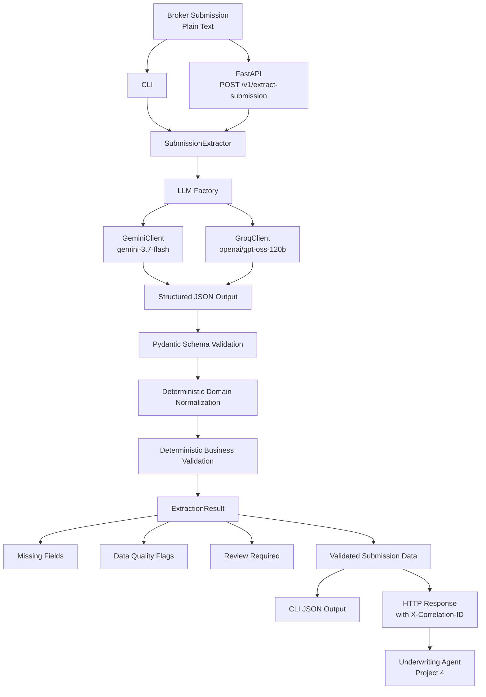
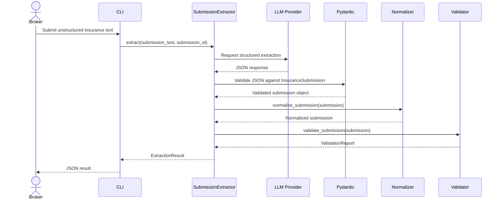
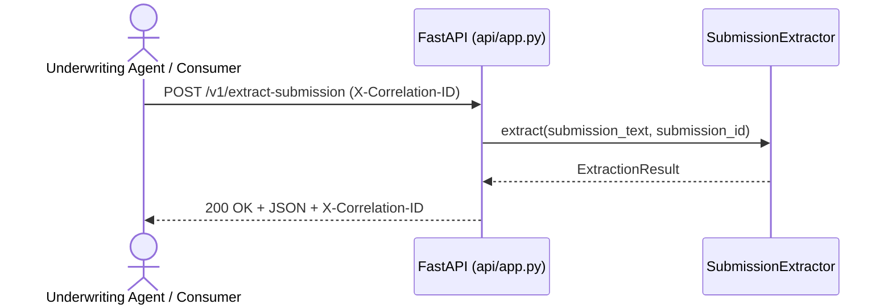
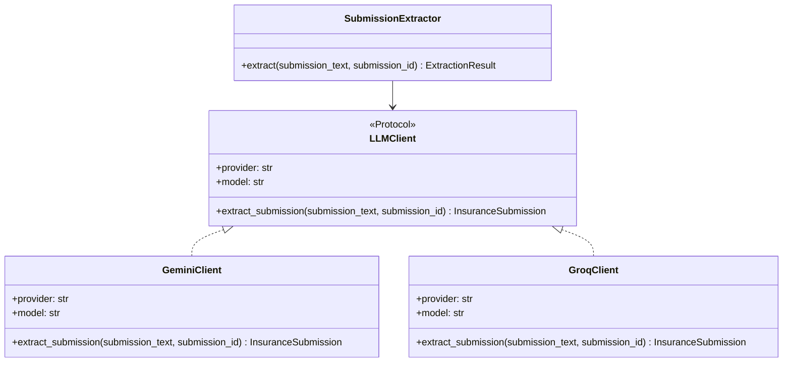
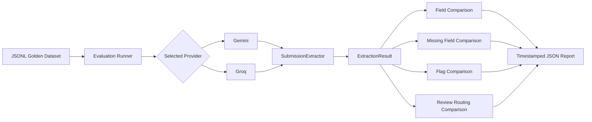
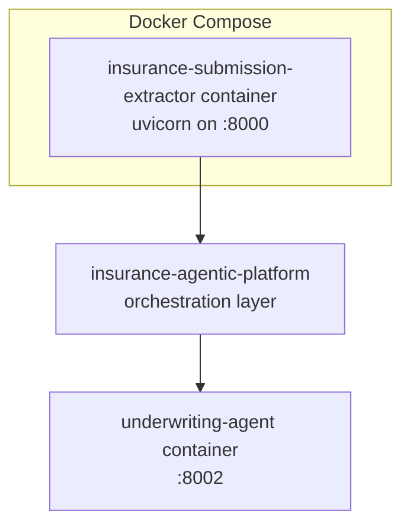
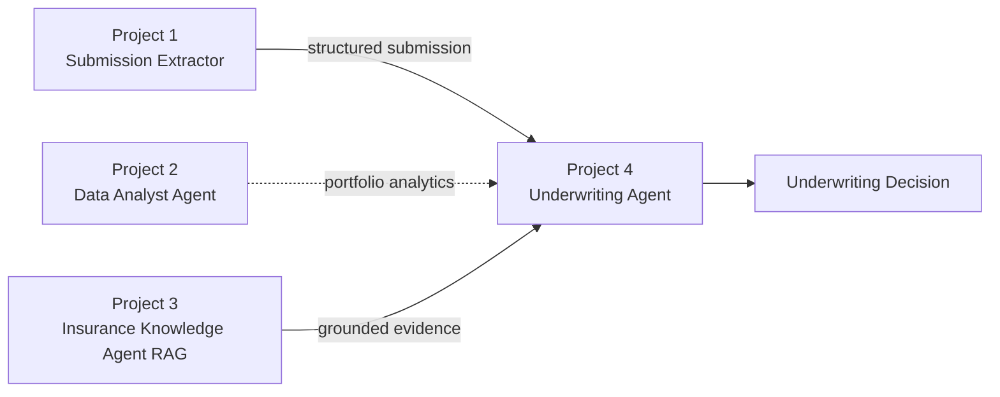

# System Architecture

## Purpose

This document describes the architecture of the Insurance Submission Extractor.

The application transforms unstructured commercial insurance submissions into structured, validated, and auditable data. It is the intake and validation layer of a larger agentic insurance platform that also includes a Data Analyst Agent, an Insurance Knowledge Agent (RAG), and an Underwriting Agent.

## High-Level Architecture



## Main Components

| Component | Responsibility | Provider-Specific |
|---|---|---:|
| `cli.py` | Accepts a text submission or input file and prints a JSON result | No |
| `api/app.py` | Exposes the FastAPI HTTP service (`/health`, `/v1/extract-submission`, `/docs`) with `X-Correlation-ID` propagation | No |
| `config.py` | Loads validated runtime configuration from environment variables | No |
| `llm/base.py` | Defines the common LLM client contract | No |
| `llm/factory.py` | Creates the client selected by `LLM_PROVIDER` | No |
| `llm/gemini_client.py` | Calls Gemini and parses structured output | Yes |
| `llm/groq_client.py` | Calls Groq and parses structured output | Yes |
| `schemas/submission.py` | Defines Pydantic contracts and domain enums | No |
| `schemas/integration.py` | Defines the API/integration-facing response contract | No |
| `services/extractor.py` | Coordinates extraction, normalization, and validation | No |
| `services/normalizers.py` | Applies deterministic domain mappings | No |
| `services/validators.py` | Identifies missing fields and business-rule issues | No |
| `evaluation.py` | Compares results against the golden dataset | No |
| `scripts/run_evaluation.py` | Runs provider-specific benchmark evaluations | No |

## Extraction Sequence (CLI)



## Extraction Sequence (HTTP API)



## Validation Layers

| Layer | Purpose | Example |
|---|---|---|
| LLM structured extraction | Convert unstructured text into a known JSON shape | Extract annual revenue from a broker submission |
| Pydantic validation | Enforce types, enums, numeric constraints, and internal model consistency | Reject a future claim year or an unsupported claim type |
| Deterministic normalization | Apply explicit and versioned domain mappings | Map business activity `Restaurant` to occupancy type `restaurant` |
| Deterministic business validation | Identify missing or inconsistent underwriting information | Flag a building construction year later than a reported claim year |

## Provider Abstraction



The application business layer depends on the `LLMClient` contract, not on a provider SDK. This allows Gemini and Groq to be selected through environment configuration without changing schemas, validation rules, normalization logic, CLI behavior, API behavior, or evaluation code.

## Evaluation Architecture



The evaluation runner measures provider behavior against a versioned synthetic golden dataset. It evaluates expected fields, acceptable semantic alternatives, expected missing fields, deterministic data-quality flags, and the `review_required` routing signal.

## Deployment Architecture



The service can run standalone via its own `Dockerfile` and `compose.yaml`, or as part of the centralized `insurance-agentic-platform` Docker Compose stack alongside the Underwriting Agent.

## Security Boundaries

```text
Tracked by Git
- Source code
- Tests
- Synthetic submissions
- Golden dataset
- Documentation
- .env.example
- uv.lock
- Dockerfile, compose.yaml

Never tracked by Git
- .env
- API keys
- Real customer submissions
- Real claims data
- Generated evaluation reports
```

All current examples and datasets are synthetic. The application must not send real policyholder or claims data to external LLM providers without a documented data-governance, privacy, contractual, and security review.

## Role in the Broader Agentic Platform



The Insurance Submission Extractor is intentionally limited to intake, normalization, and validation. It does not make underwriting decisions or pricing recommendations; those responsibilities belong to the Underwriting Agent, which combines this project's output with retrieval from the Insurance Knowledge Agent and deterministic underwriting rules.

## Recommended Technology Upgrades

| Area | Current | Recommended (2026) | Benefit |
|---|---|---|---|
| Observability | No tracing | Langfuse or OpenTelemetry | End-to-end trace of every extraction: provider, cost, latency, retries |
| Structured generation | Manual prompt + JSON parsing | Pydantic AI or native structured-output modes | Fewer schema mismatches at the source |
| Persistence | Flat JSON evaluation reports | PostgreSQL + SQLAlchemy 2.0 async | Queryable, shared audit trail across projects |
| API design | Direct function calls | Dependency injection (`Depends()`), repository pattern | Cleaner separation between transport and business logic |
| Batch handling | Synchronous requests only | FastAPI `BackgroundTasks` or ARQ queue | Supports bulk submission ingestion |

## Improvements and Next Steps

1. Add distributed tracing (Langfuse or OpenTelemetry) around the extraction pipeline for cost, latency, and failure visibility.
2. Persist `ExtractionResult` and evaluation outputs in PostgreSQL to support cross-project reporting with the Data Analyst Agent.
3. Add end-to-end tests validating `X-Correlation-ID` propagation from this service through the Underwriting Agent.
4. Introduce per-request cost and retry budgets in `config.py`.
5. Version prompt changes explicitly with a changelog for `prompts/extraction_prompt.py`.

## Agentic AI Best Practices Applied Here

- **Single-responsibility agent boundary**: extraction and validation only, no underwriting or pricing logic.
- **Deterministic guardrails on generative output**: Pydantic validation, normalization, and business rules gate every LLM response before it is trusted.
- **Explicit human-escalation signal**: `review_required` provides an inspectable handoff rather than a silent model decision.
- **Provider abstraction as resilience**: the `LLMClient` protocol enables failover or comparison between Gemini and Groq without touching business logic.
- **Correlation-first design**: `X-Correlation-ID` propagation supports auditing a single request across the whole agentic platform.
- **Next practice to adopt**: expose this extractor through an MCP-compatible tool contract so any orchestrator (including the Underwriting Agent) can call it through a standardized interface rather than a bespoke HTTP client.
